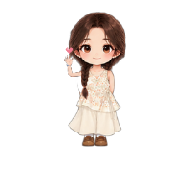

# 自定义桌宠petforge

**Make a desktop companion from your own character image.**

## Try the finished desktop pet

[Download the Windows portable release](https://github.com/lesile1312/PetForge/releases/tag/v1.0.0), extract the whole ZIP, then double-click `Start-PetForge.bat`. Drag the character, right-click to cycle interactions, and press Esc while the pet has focus to exit. She wanders and performs gestures including waving with a little heart, fixing her hair, looking in a mirror, and using a phone. Godot is included.

To make your own pet, follow the transparent PNG or local editor instructions below. You can adjust the appearance and desktop behavior. The example girl's detailed motions were authored for her; another image does not automatically inherit them.

For action-frame format and adjustments, see [the pet package format](docs/pet-format.md); a [Chinese guide to making your own motions](docs/customize-your-pet.zh-CN.md) describes the process.



[中文文档](README.zh-CN.md) · **English** · [Live demo](https://lesile1312.github.io/PetForge/#example) · [Create with your reference](https://lesile1312.github.io/PetForge/#create)

I am focusing first on the part I can make work well: put your own character image on the desktop, adjust its size, walking speed, idle and sleep habits, then save or launch it. If you already have a transparent PNG, you can use it as-is. A regular photo can go through local background removal, but the result depends on the photo. Automatic high-quality cartoon redraw and custom actions for every photo are not reliable yet, so I do not present them as finished features.

## New here? Start with the route that fits

| What you want to do | Follow this route | You will need |
| --- | --- | --- |
| I want to adjust the character and desktop behavior | [Run the local pet editor](#quick-start-windows-development) (transparent PNG works directly; photo cutout is optional) | Windows, Node.js, pnpm, Python, and Godot 4 |
| I just want to start a pet quickly | [Use a transparent PNG](#make-your-own-pet--transparent-png-route) ([download source ZIP](https://github.com/lesile1312/PetForge/archive/refs/heads/main.zip)) | Windows, Godot 4, and the 自定义桌宠petforge source |
| I only want to preview the project | [Open the live demo](https://lesile1312.github.io/PetForge/#example) | A browser; the demo cannot launch a pet on your computer |

**Where I am now:** The local editor can import a transparent character PNG directly, adjust its look and behavior, preview it, save a package, and launch it on the Windows desktop when Godot is configured. Regular photos can use local background removal, but that does not redraw them into the polished cartoon girl shown here. The 18 illustrated actions are custom work for my character; new images get the runtime's built-in general actions. The repository provides source code and a Windows portable ZIP for the example pet. GitHub Pages is a showcase and cannot launch a pet on your computer. 自定义桌宠petforge is an independent community project and is not affiliated with OpenAI or Codex.

## How I built this character, one change at a time

At first, the pet sometimes did not show up, lost its color, or had hair and feet cut off. Then I kept adjusting the run, blink, wave, mirror, hair, and phone motions. The arms, eyes, expressions, and timing often needed another pass. I would run it, spot something odd, change a small part, and try again. That process shaped the character and the action showcase you see here.

I want people to keep shaping their own pets too: choose a character image, adjust its size, speed, wandering frequency and rest time, preview it, then keep changing anything that feels off. The final version comes from the user's choices. Automatic cartoon redraw and photo-specific motions are still experimental, so I am putting the reliable transparent-PNG-to-desktop path first.

## From the original photo to the custom character

<p align="center">
  
  
</p>

These images show the same creator-owned character: the provided reference photo and the custom cartoon girl designed and refined over multiple iterations. The website showcase, its action previews, and the desktop runtime default use the same character assets. This is a custom case; arbitrary photo uploads do not automatically receive the same artwork or animation rig.

<p align="center"></p>

[View the original-photo comparison](https://lesile1312.github.io/PetForge/#example) · [View run-cycle frames](docs/images/pet-demo/run-cycle.png)

## 18 actions in the custom character showcase

[Browse the full illustrated action catalog and watch the motion previews](https://lesile1312.github.io/PetForge/#actions). The page includes 18 character-specific action illustrations and three animated previews rendered from the Godot desktop runtime at 60 FPS, including a full 16-second phone interaction.

- **Everyday (4):** quiet breathing idle, waiting for input, blink and smile, sleep.
- **Movement (2):** run left, run right.
- **Greetings and gestures (11):** wave and smile, happy smile, bow, adjust hair, look in a mirror, chin-rest thinking, look around, shy face touch, stretch, covered-mouth laugh, send a heart.
- **Phone interaction (1):** crouch, watch the screen, tap, and swipe.

These are custom assets for the showcased character. A newly uploaded image does not automatically receive these poses, animation frames, or a character-specific rig.

## What you can use today

| Capability | Current behavior |
| --- | --- |
| Your own transparent PNG → desktop pet | Imports directly without cutout, preserves the source, and creates a runnable package |
| Start from a regular photo | Optional local person cutout and light comic filter; it does not redraw or complete the character |
| Desktop window | Transparent, borderless, draggable, optionally always on top; independent of the browser |
| Behavior | The showcased character has 18 custom action illustrations; the generic runtime provides idle, movement, sleep, jump and click reactions. Other images do not inherit this character's gestures automatically |
| Portable package | `pet.json` and `character.png`; optional cutout and static GLB |
| Public website | Reference-photo preview and `.petforge.json` download; no cloud photo generation |
| Automatic cartoon redraw and photo-specific actions | Still experimental; not promised as an available feature. See the [technical design](docs/photo-to-pet-technical-design.zh-CN.md) |

Choose **I have a transparent character PNG** before uploading a ready-made sprite; this skips photo processing. New characters use the runtime's built-in general actions and do not automatically receive the showcased character's custom run frames or gestures.

## Make your own pet — transparent PNG route

Requires Windows 10/11 x64, PowerShell, Git (or a downloaded repository ZIP), and a Godot 4 executable. This route does not require Node.js, Python, CUDA or an AI account.

1. Clone the repository, or download and extract its ZIP:

```powershell
git clone https://github.com/lesile1312/PetForge.git
cd PetForge
```

2. Prepare a transparent PNG with the whole character visible. Keep padding around hair, hands and feet. A PNG with an opaque background will display that background too.
3. Run this command, replacing both example file paths with your own:

```powershell
.\scripts\create-pet.ps1 -ImagePath 'C:\Pictures\my-character.png' -Name 'My companion' -GodotExecutable 'C:\Tools\Godot\Godot.exe'
```

The script prints the package folder and starts the pet. Each run creates a new folder under `storage/custom-pets/`; it does not modify your source image or overwrite existing packages. To create files without starting Godot:

```powershell
.\scripts\create-pet.ps1 -ImagePath 'C:\Pictures\my-character.png' -Name 'My companion' -NoLaunch
```

Drag with the left mouse button, right-click to cycle interactions, and press Esc while the pet has focus to quit. The small pet window can appear over other applications. Action quality depends on the image and available rig, especially for a single flat PNG.

## Quick start (Windows development)

Use the full local editor when starting from a photograph.

### Requirements

- Windows 10/11 x64; Git or the extracted repository ZIP.
- Node.js 22.13+ and pnpm 11.19.0 (as declared in `package.json`; pnpm requires this Node version).
- Python 3.12 with the Windows `py` launcher or `python.exe` on PATH.
- Godot 4 to run the desktop pet. The current project has been developed with Godot 4.7.2; use a compatible Godot 4 build.
- Internet access for dependency installation and the first segmentation-model download. CPU segmentation is supported; a CUDA GPU is only needed for the separate TripoSR experiment.

### Install, configure, start

From the repository root:

```powershell
npm install --global pnpm@11.19.0
.\scripts\setup.ps1
```

The setup script creates `.env` if missing. Edit this line to point to your installed executable:

```dotenv
PETFORGE_GODOT_EXECUTABLE=C:/Tools/Godot/Godot.exe
```

Then start both local services:

```powershell
pnpm dev
```

Keep that terminal open and visit <http://127.0.0.1:3000/>. API health: <http://127.0.0.1:8000/health>.

### Create, adjust, and launch

1. Visit `http://127.0.0.1:3000/`. Choose **I have a transparent character image** or **I only have a regular photo**, then pick an image (up to 10 MB). Transparent PNGs are used directly; regular photos go through local background removal.
2. Adjust the name, character size, movement speed, wandering frequency, jumping, sleeping, dragging, and window behavior. Preview updates as you make changes.
3. Click **Save settings** to keep the current setup. Click **Download pet package** to export `pet.json` and the transparent character PNG.
4. In local mode, configure Godot in `.env` and click **Launch pet**. The pet appears in its own desktop window outside the browser.
5. If you started from a photo, inspect the hair, hands, feet, and edges. Cutout cannot restore parts hidden or missing in the source, and it does not draw a new cartoon character.

The ZIP is a resource package, not a Windows installer. Anyone receiving it also needs Godot 4 or the matching runtime.

3D generation is an explicit optional action, so making a 2D pet does not wait for TripoSR. Install the separate environment with `scripts/setup-ai.ps1` only if you want the static 3D preview. It can download large files and requires compatible CUDA hardware.

### Run an exported pet again

Extract the resource ZIP into its own folder. Keep `pet.json` beside `character.png` and preserve any referenced assets. Run:

```powershell
& 'C:\Tools\Godot\Godot.exe' --path '.\apps\desktop' -- --pet-project 'C:\MyPets\MyCompanion'
```

Run this from the repository root. The pet continues independently of the web editor; Esc exits the focused pet. To share a package, recipients also need this project and Godot or a compatible 自定义桌宠petforge runtime. Exporting only the ZIP does not install that runtime on another computer.

## Troubleshooting

| Symptom | What to check |
| --- | --- |
| `127.0.0.1:3000` cannot open | Start `pnpm dev` on that computer and keep the terminal open. The public Pages site does not start local services. |
| Launch reports Godot is not configured | Set the actual executable path in `.env` and restart services; `create-pet.ps1` accepts `-GodotExecutable` directly. |
| Script execution is blocked | Open a PowerShell session with a process-only policy, e.g. `powershell -NoProfile -ExecutionPolicy Bypass`, then run the command there after reviewing the script. No machine-wide policy change is needed. |
| Installation fails | Check Node/pnpm/Python versions and the terminal error; rerun `scripts/setup.ps1` after correcting it. |
| First segmentation is slow or fails | Model loading may require a download. Check the API terminal, network and free disk space. A transparent PNG can use the direct route while you resolve model setup. |
| The output looks like a filtered photo | That is the present photo-processing capability. Supply a prepared cartoon PNG for a cartoon character. |
| Hair or a foot is missing | Check the source and segmentation result. Add transparent padding; the runtime cannot recover body parts missing from the source. |
| New image does not perform the sample's gestures | The sample uses custom art. A new PNG gets generic runtime behavior, not a matching newly generated skeletal rig. |
| 3D fails | 2D creation still works. 3D is optional and needs its separately installed environment. |

## Privacy, licenses and contribution

Visitor photos selected on the static website remain in that browser unless the visitor saves/shares the reference file. The local editor sends images to FastAPI on the same machine; source images, generated files and project data live under `storage/` by default. Choose another location with `PETFORGE_STORAGE_ROOT` and `PETFORGE_DATABASE_PATH`. Neither runtime script uploads photos. Do not commit `.env`, personal projects or model caches.

The demonstration photo was published at the creator's request. Its display does not grant reuse rights; see [third-party notices](THIRD_PARTY_NOTICES.md). Source code is [Apache-2.0](LICENSE); model weights and artwork have separate terms.

The API is a local development service. Public hosting requires additional access control, quotas, storage and retention policies. Dependencies also need regular security updates; a development build is not a security audit.

Contributions to installer packaging, automatic character rigging, natural gestures and accessible editing are welcome. Include reproduction steps and your OS/version in issues; omit private photos and credentials.

## Project structure and design

See the [workflow validation record](docs/validation-2026-10-23.md) for what was checked locally and the remaining verification boundaries.

```text
apps/web/              Next.js local editor
apps/desktop/          Godot transparent desktop runtime
services/api/          FastAPI and local image processing
packages/pet-schema/   Shared pet configuration contracts
scripts/create-pet.ps1 Direct image-to-runtime workflow
storage/               Local private projects (ignored by Git)
docs/                  Public website and technical documentation
```

[Architecture](docs/architecture.md) · [Photo-to-pet design](docs/photo-to-pet-technical-design.zh-CN.md) · [Package format](docs/pet-format.md) · [Development](docs/development.md) · [Project status](docs/project-status.md)
