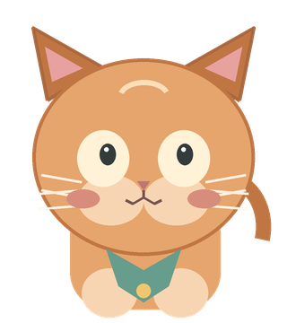
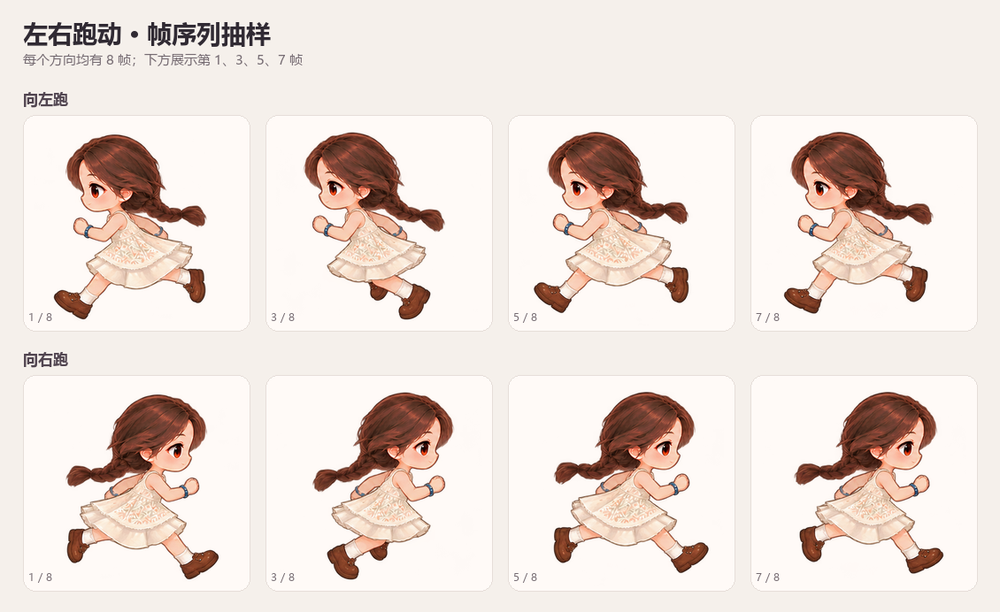

# PetForge

**Turn your character into a desktop companion.**

PetForge is a Windows-first, local desktop-pet studio. Upload a character image, create a transparent 2D companion, preview its behavior in the editor, and let it move across your desktop in a lightweight Godot window.

PetForge is an independent community project. It is not affiliated with or endorsed by OpenAI or Codex.

**Project showcase / 项目演示页:** <https://lesile1312.github.io/PetForge/>

<p align="center">
  
</p>

**中文简介：** PetForge（AI 桌宠工坊）是一款面向 Windows 的本地桌宠创作工具。上传人物图片、预览卡通角色与动作，再让透明桌宠在整个桌面上活动。默认本地流程不会把用户照片发送到云端。

## What works today

- **Photo to character:** locally segments a portrait, preserves a transparent cutout, and creates a comic-style sprite for the desktop pet.
- **Desktop companion:** a separate, borderless, transparent Godot 4 runtime supports dragging, screen bounds, and desktop movement. Drag with the left mouse button, right-click the pet to cycle an action, and press Esc to exit. The public cat is a basic demo; advanced hand-tuned gestures require character-specific art and rig data.
- **Editor and project settings:** adjust the pet's appearance and behavior in a Next.js editor backed by a local FastAPI service.
- **Portable pet package:** export the character and its configuration for a compatible PetForge runtime.
- **Optional 3D experiment:** reconstructs a separate static GLB for viewing. It is not the animated desktop character, and unseen surfaces are inferred.

The image-to-cartoon step currently uses local palette, contour, and outline processing. It does not redraw every photo into a new anime illustration. Automatic character-part detection and rigging for arbitrary uploaded photos are planned; check the [technical design](docs/photo-to-pet-technical-design.zh-CN.md) for the implementation path and current limits. The source repository includes a generic sample cat and the small photo-inspired demo gallery below. It does not include the original reference photo or local editing files.

## Desktop-pet demo / 桌宠演示

This creator-provided example shows the supported idle, blink, and left/right run frame sets. The running preview samples four of the eight frames in each direction. These hand-tuned demo assets illustrate the runtime; they do not mean arbitrary uploaded portraits already receive the same detailed animation automatically.

这组创作者提供的示例展示了当前桌面运行时已接入的待机、眨眼和左右跑帧组。跑动预览从每个方向的 8 帧中抽取了 4 帧。它展示的是定制示例素材，不代表任意上传照片都已能自动生成同等精细的动作。

<p align="center">
  
</p>

<p align="center">
  
</p>

Individual transparent frames are available in [`docs/images/pet-demo/`](docs/images/pet-demo/).

## Quick start (Windows development)

### Prerequisites

- Windows 10/11, x64
- Node.js 20.9 or newer and pnpm
- Python 3.12
- Godot 4 (for the separate desktop runtime)
- NVIDIA GPU and CUDA-compatible environment for the optional local TripoSR 3D experiment

### Install and launch the editor

```powershell
Copy-Item .env.example .env
.\scripts\setup.ps1
pnpm dev
```

Open <http://localhost:3000>. The API health endpoint and interactive API documentation are at <http://127.0.0.1:8000/health> and <http://127.0.0.1:8000/docs>.

The setup script installs the local API and portrait-segmentation dependencies. To enable the optional 3D experiment, run `scripts/setup-ai.ps1` separately. It downloads large model weights and a dedicated CUDA/PyTorch environment. Photos are processed by the local API; model and dependency downloads require internet access. Review each upstream model's license before redistribution or commercial use.

To enable the editor's desktop launch button in development, set `PETFORGE_GODOT_EXECUTABLE` in `.env` to the Godot 4 executable on your machine. For example:

```dotenv
PETFORGE_GODOT_EXECUTABLE=C:/Tools/Godot/Godot_v4.7.2-stable_win64.exe
```

The Windows export preset is a starting point. Export templates, a packaged creator/player installer, and a signed end-user release still need to be prepared and verified.

## Project layout

```text
apps/web/                 Next.js image-creation editor
apps/desktop/             Godot 4 transparent desktop runtime
services/api/              FastAPI, SQLite, local storage and image providers
packages/pet-schema/       Shared TypeScript and JSON Schema contracts
assets/demo/               License-safe web editor examples
docs/                      Architecture, API, package and development docs
scripts/                   Windows development and local-model setup
```

## Privacy and local data

In the default local setup, the browser talks to the API on the same computer. Uploaded photos, generated files, SQLite data, and logs are stored under `storage/`. The original photo is kept locally so the user can restore it. Set `PETFORGE_STORAGE_ROOT` or `PETFORGE_DATABASE_PATH` in `.env` to choose another location.

Model weights are downloaded separately and can occupy several gigabytes. They are not bundled with this repository. A public deployment needs a separate security, account, storage, consent, and retention design; the development API is not a public image-processing service.

## Development status and design

This repository is a runnable local-development foundation for the upload, image-processing, editor, export, and desktop-runtime paths. It is not yet a packaged consumer installer or an automatic high-quality animation-rigging service for arbitrary photos.

- [Public development status](docs/project-status.md)
- [Photo-to-pet technical design](docs/photo-to-pet-technical-design.zh-CN.md)
- [Current project audit](docs/current-state-audit.zh-CN.md)
- [Architecture](docs/architecture.md) · [API](docs/api.md) · [Pet package format](docs/pet-format.md) · [AI providers](docs/ai-providers.md) · [Development](docs/development.md)

## License

Project source code is licensed under the [Apache License 2.0](LICENSE). Model weights, generated outputs, and third-party assets are governed by their own licenses and terms. See [third-party notices](THIRD_PARTY_NOTICES.md).

