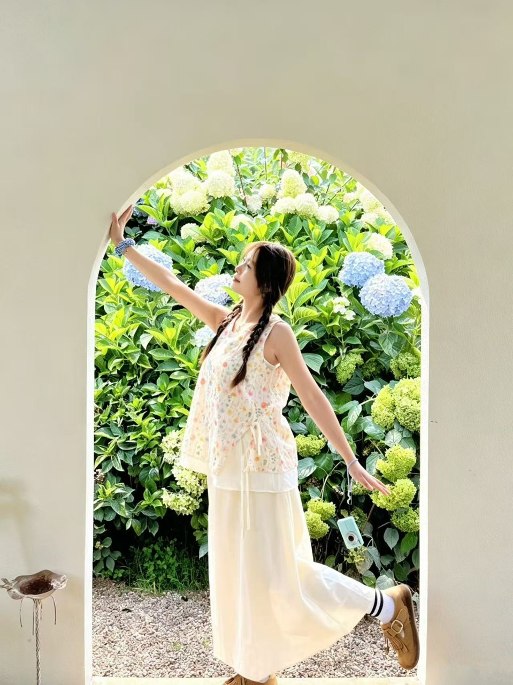
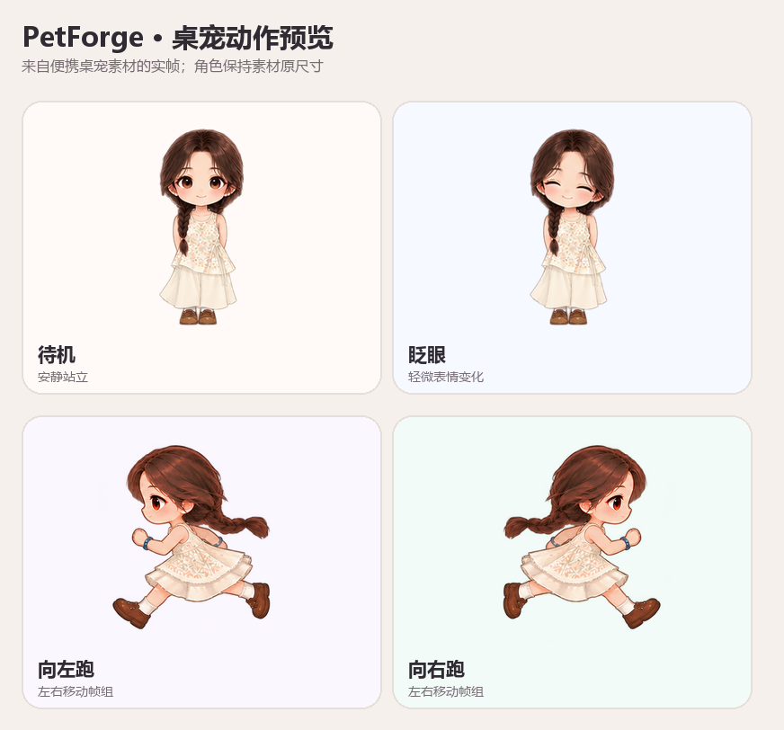

# 自定义桌宠petforge

**把你自己的角色图片，做成住在电脑桌面上的小伙伴。**

**中文** · [English](README.md) · [真人原图与桌宠演示](https://lesile1312.github.io/PetForge/#example) · [参考图入口](https://lesile1312.github.io/PetForge/#create)

我先把这件事做实：把你自己的角色图片放到桌面，再调大小、走路速度、待机和睡觉习惯，最后保存或启动桌宠。有完整透明 PNG 的人可以直接开始；普通照片也能在本机抠背景，但结果会受照片影响。自动重画成精细卡通、给每张照片生成专属动作，目前还做不到稳定好用，所以我不把它当成现成能力来宣传。

## 第一次使用？从这里开始

先选符合你现在情况的路线：

| 你的目标 | 适合的路线 | 需要准备 |
| --- | --- | --- |
| 我想调整角色大小、移动和桌面行为 | [运行本机桌宠编辑器](#路线二运行本机桌宠编辑器)（先用透明 PNG；也能选普通照片抠图） | Windows、Node.js、pnpm、Python、Godot 4 |
| 我只想快速启动一只桌宠 | [用透明 PNG 快速启动](#路线一直接用自己的透明-png制作桌宠)（[下载源码 ZIP](https://github.com/lesile1312/PetForge/archive/refs/heads/main.zip)） | Windows、Godot 4、自定义桌宠petforge 源码 |
| 我只想先看看效果 | [打开演示网页](https://lesile1312.github.io/PetForge/#example) | 浏览器；演示网页不会在电脑上启动桌宠 |

**我目前做到这里：** 本机编辑器已经能直接导入透明角色 PNG，调外观和行为，预览、保存资源包；配置好 Godot 后还能把桌宠显示在整个 Windows 桌面上。普通照片可以本机抠图，但它不会自动变成我展示的精细卡通女孩。网页里的 18 个动作是我为自己的角色慢慢调整出来的；新角色现在使用通用桌宠动作。仓库提供源码，还没有一键安装包。GitHub Pages 只展示作品，不能替你启动本机桌宠。本项目是独立社区项目，与 OpenAI 或 Codex 无隶属关系。

## 我是怎么一步步做出来的

一开始，桌宠有时不显示、颜色不对，抠图还会盖住头发或切掉身体。后来我又反复调整跑步、眨眼、招手、照镜子、整理头发和玩手机的动作，尤其是手臂、眼神、表情和动作速度。它不是一次生成就完成的，而是看效果、找问题、改一点、再运行，慢慢变成现在这套角色和动作展示。

我希望大家做自己的桌宠时也能这样反复改：先选好角色图，再调大小、速度、走动频率和休息时间，预览后觉得不合适就接着改。上传照片只是起点，最后的样子由自己挑选和调整。照片自动重画和专属动作生成还不稳定，我先把透明 PNG 到桌面运行这条路做好。

## 真人照片与卡通桌宠对照

<p align="center">
  
  
</p>

左右图展示同一位作者自有角色：本人提供的参考照片，以及参照人物特征人工设计并多轮调整的卡通女孩。网站展示、动作预览与桌面运行器内置示例复用这套素材。**这只是定制案例；上传任意照片不会自动生成同等精细的卡通立绘和动作绑定。**

<p align="center"></p>

[查看网页对照](https://lesile1312.github.io/PetForge/#example) · [查看跑步帧组](docs/images/pet-demo/run-cycle.png)

## 定制角色的 18 种动作

[查看完整动作图册和动画预览](https://lesile1312.github.io/PetForge/#actions)。网页展示 18 张角色动作图，并提供 3 段由 Godot 桌面运行器以 60 FPS 原速渲染的动画，其中包含完整 16 秒的玩手机动作。

- **日常状态（4）**：安静呼吸待机、等待输入、眨眼微笑、睡觉。
- **移动（2）**：向左跑动、向右跑动。
- **问候与手势（11）**：招手微笑、开心微笑、点头致意、整理头发、照镜子、托腮思考、左右张望、害羞摸脸、抬手舒展、捂嘴轻笑、送出小爱心。
- **手机互动（1）**：蹲下看屏幕、点按、滑动。

这些是展示角色专用的动作素材。新上传的图片不会自动获得这些姿势、动画帧或角色专属绑定。

## 当前能做什么

| 功能 | 当前状态 |
| --- | --- |
| 用自己的透明 PNG 制作桌宠 | 编辑器可直接导入，不经过抠图；保留原图并生成可运行资源包 |
| 从普通照片开始 | 可选本机人物抠图与轻量漫画滤镜；不会自动重画卡通或补全人物 |
| 显示在整个桌面 | 独立透明无边框窗口，可拖动、置顶，独立于浏览器 |
| 行为互动 | 展示角色有 18 种专属动作图；通用运行器提供待机、移动、睡眠、跳跃和点击反馈。其他图片不会自动继承该角色的细致手势 |
| 导出资源 | `pet.json`、`character.png`，以及可选抠图和静态 GLB |
| 公开网页 | 本地选图预览和保存 `.petforge.json` 参考文件，不提供云端图片生成 |
| 自动卡通重绘与照片专属动作 | 仍属实验方向，当前不作为可用功能承诺；详见[技术设计](docs/photo-to-pet-technical-design.zh-CN.md) |

普通 PNG/JPG/WEBP 走照片处理路线；若已有透明 PNG，请在上传前选择“我有透明角色图”，这样会跳过抠图。当前每张新角色都使用运行器自带的通用动作，不会自动获得展示角色的专属跑步帧和手势。

## 路线一：直接用自己的透明 PNG，制作桌宠

需要 Windows 10/11 x64、PowerShell、项目源码与 Godot 4。**这条路线无需 Node.js、Python、CUDA 或 AI 账号。**

1. 下载并解压仓库 ZIP，或克隆项目：

```powershell
git clone https://github.com/lesile1312/PetForge.git
cd PetForge
```

2. 准备透明 PNG：人物完整，头发、手脚四周留出透明边距。如果原图有不透明背景，桌宠也会带着该背景显示。
3. 将命令中的两个路径换成你自己的图片路径和 Godot 可执行文件路径：

```powershell
.\scripts\create-pet.ps1 -ImagePath 'C:\Pictures\my-character.png' -Name '我的桌宠' -GodotExecutable 'C:\Tools\Godot\Godot.exe'
```

脚本会显示生成目录并启动宠物。每次新建一个 `storage/custom-pets/` 子文件夹，保留原始图片，不覆盖已有资源包。只制作文件、暂不启动时使用：

```powershell
.\scripts\create-pet.ps1 -ImagePath 'C:\Pictures\my-character.png' -Name '我的桌宠' -NoLaunch
```

鼠标左键拖动，右键切换互动；让宠物获得焦点后按 Esc 退出。宠物显示在独立桌面窗口中。单张平面 PNG 的动作表现取决于图片及现有绑定，不能直接获得示例的全部精细动作。

## 路线二：运行本机桌宠编辑器

### 准备环境

- Windows 10/11 x64；Git 或下载解压后的仓库。
- Node.js 22.13 以上、pnpm 11.19.0（与项目 `package.json` 一致；pnpm 需要此 Node 版本）。
- Python 3.12，确保 `py` 启动器或 `python.exe` 可用。
- Godot 4，项目当前开发使用 Godot 4.7.2，请选择兼容的 Godot 4 版本。
- 安装依赖和首次下载抠图模型时需要联网。2D 人物抠图可用 CPU；CUDA 显卡只属于可选的 TripoSR 实验要求。

### 安装与启动

在项目根目录执行：

```powershell
npm install --global pnpm@11.19.0
.\scripts\setup.ps1
```

安装脚本会在 `.env` 不存在时创建它。编辑其中这一行，填写你电脑上的实际路径：

```dotenv
PETFORGE_GODOT_EXECUTABLE=C:/Tools/Godot/Godot.exe
```

然后启动网页和 API：

```powershell
pnpm dev
```

保持终端打开，访问 <http://127.0.0.1:3000/>。API 健康检查地址为 <http://127.0.0.1:8000/health>。公开 GitHub Pages 网页不会自动启动你电脑上的服务。

### 创建、调整并启动

1. 打开 `http://127.0.0.1:3000/`，选择 **我有透明角色图** 或 **我只有普通照片**，再选一张图片（最大 10 MB）。透明 PNG 会直接使用；普通照片会在本机抠图。
2. 在编辑器里设置名字、角色大小、移动速度、散步频率、跳跃、睡眠、拖动和窗口显示习惯。预览会跟着更新。
3. 点击 **保存设置** 保留当前配置。按 **下载资源包** 可导出 `pet.json` 和透明角色 PNG。
4. 本机模式配置好 `.env` 里的 Godot 路径后，点击 **启动桌宠**。宠物会出现在独立桌面窗口，不局限于浏览器。
5. 如果从普通照片开始，先检查头发、手脚和边缘。抠图不会修复原照片里被遮住或没拍到的部分，也不会生成新的卡通立绘。

导出的 ZIP 是资源包，不是 Windows 安装程序。把项目发给别人时，对方也需要安装 Godot 4 或获得配套运行器。

**2D 制作不会自动运行 3D 建模。** 只有你主动选择可选的 3D 实验时，才需要单独运行 `scripts/setup-ai.ps1` 配置 TripoSR。它会下载较大的模型与运行环境，需要兼容的 CUDA 显卡。

### 再次启动或分享导出的宠物

把 ZIP 解压到独立目录，保留 `pet.json`、`character.png` 和它引用的素材。在项目根目录执行：

```powershell
& 'C:\Tools\Godot\Godot.exe' --path '.\apps\desktop' -- --pet-project 'C:\MyPets\MyCompanion'
```

替换为你的实际路径。桌宠可以独立于网页运行；让宠物获得焦点后按 Esc 退出。发给别人试用时，对方也需要本项目与 Godot，或兼容的自定义桌宠petforge 桌面运行器；单发资源 ZIP 不会自动为对方安装运行程序。

## 常见问题

| 问题 | 处理办法 |
| --- | --- |
| 打不开 `127.0.0.1:3000` | 先在这台电脑启动 `pnpm dev`，保持终端运行。公网演示页不等于本机编辑器。 |
| 提示未配置 Godot | 填好 `.env` 的实际可执行文件路径并重启服务；直启脚本使用 `-GodotExecutable`。 |
| PowerShell 禁止运行脚本 | 阅读脚本后，可用 `powershell -NoProfile -ExecutionPolicy Bypass` 新开仅当前进程放行的终端再执行，无需修改整机策略。 |
| 安装失败 | 核对 Node、pnpm、Python 版本，按终端报错修复后重跑 `scripts/setup.ps1`。 |
| 抠图很慢或失败 | 首次可能下载模型；检查 API 终端、网络和磁盘空间。也可以先用透明 PNG 路线。 |
| 看起来只是照片滤镜 | 当前就是抠图加漫画滤镜。希望使用 Q 版角色时，请先提供画好的透明卡通 PNG。 |
| 头发或脚被裁掉 | 检查原图与抠图边缘，保留透明边距；运行器无法恢复原图已经缺失的部分。 |
| 自己的图片没有演示人物的动作 | 演示角色使用定制素材，新 PNG 只获得通用行为，不会自动生成同样的肢体绑定与新动画帧。 |
| 3D 模型失败 | 继续使用 2D 桌宠。3D 是单独实验，需要额外环境。 |

## 隐私、开源许可与贡献

公开网页选图只在当前浏览器预览，除非用户主动下载或分享参考文件。本机编辑器把照片发送到同一台电脑的 FastAPI；原图、生成图和数据库默认保存在 `storage/`。可以通过 `PETFORGE_STORAGE_ROOT` 和 `PETFORGE_DATABASE_PATH` 修改位置。直启脚本不上传图片。请勿提交 `.env`、个人项目和模型缓存。

演示真人照片是按创作者要求公开展示的素材，不随源代码许可授予再利用权，见[第三方与素材说明](THIRD_PARTY_NOTICES.md)。源代码采用 [Apache-2.0](LICENSE)，模型权重与素材遵循各自条款。

API 当前面向本地开发；公开托管前需要补齐访问控制、配额、存储和照片保留策略。依赖需要持续安全更新，开发构建通过不等于完成安全审计。

欢迎贡献安装包、通用角色绑定、自然动作和编辑体验改进。提交 Issue 时附复现步骤、系统与版本，避免附带私人照片和密钥。

## 工程结构与技术资料

[制作流程核对记录](docs/validation-2026-10-23.md)列出了本机已检查的环节，以及尚未覆盖的验证范围。

```text
apps/web/              Next.js 本机编辑器
apps/desktop/          Godot 透明桌宠运行器
services/api/          FastAPI 与本机图片处理
packages/pet-schema/   共享宠物配置格式
scripts/create-pet.ps1 自有 PNG 直启入口
storage/               本地私人项目，Git 忽略
docs/                  公开网页与技术文档
```

[架构](docs/architecture.md) · [照片到桌宠技术设计](docs/photo-to-pet-technical-design.zh-CN.md) · [资源包格式](docs/pet-format.md) · [开发说明](docs/development.md) · [项目状态](docs/project-status.md)
