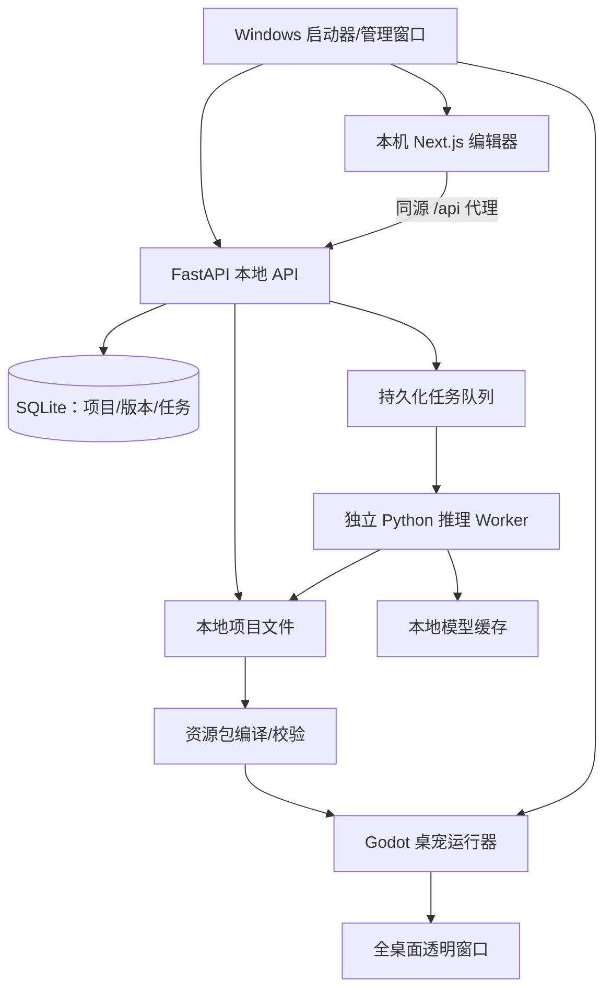
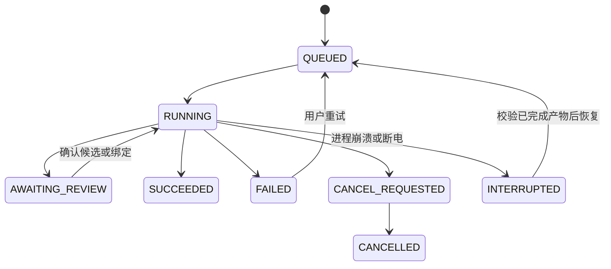

# PetForge：照片生成卡通桌宠技术设计

版本：设计草案 0.2 · 日期：2026-10-22 · 状态：供项目负责人审阅，尚未开始本轮功能实施。

本文整合现有 Next.js / FastAPI / Godot 工程与定制桌宠，定义下一阶段通用生成流程。当前代码事实及证据见 [现状审计](current-state-audit.zh-CN.md)。本文中的新增接口、目录、质量指标和安装包均为拟实施设计，不能理解为已经交付。

## 1. 已确认的产品方向

| 项目 | 已确认要求 |
| --- | --- |
| 目标 | 上传真人照片，生成有辨识度、可爱温柔又灵动的 2D 卡通桌宠 |
| 计算位置 | 优先在用户自己的电脑本地运行模型，不依赖项目方付费 API |
| 使用方式 | 从 GitHub 下载 Windows 安装包，启动后在浏览器网页上传、编辑 |
| 硬件覆盖 | 普通 Windows 电脑可用；有独显时加速，低配置可以等待更久 |
| 操作方式 | 自动处理优先；允许选择人物、确认形象、微调关键点 |
| 输入范围 | 头像、半身、全身照；缺失身体可由 AI 补全，并提示推测部分 |
| 桌面能力 | 独立透明窗口、置顶、拖动、左右跑、微表情、欢迎互动、屏幕边界处理 |
| 动画 | 原本的小尺寸，人物完整，无异常放大和裁切；动作节奏自然，目标 60 Hz 连续更新 |
| 文件 | 原图、生成候选、蒙版、模型参数、绑定结果、动作工程和中间版本保留 |
| 发布 | GitHub 开源；先 Windows，后续再评估 macOS / Linux |

产品仍暂用 **PetForge / AI 桌宠工坊**。它是独立开源项目，不宣称是 OpenAI 或 Codex 官方产品。

### 第一版的使用过程

1. 安装并启动 PetForge；首次选择数据盘和模型下载位置，完成硬件检查。
2. 自动打开本机网页；安装向导说明模型大小、许可和下载进度。
3. 上传照片，检测主体；多人或识别不确定时，让用户框选一个人。
4. 展示抠图结果，支持小范围补回头发、擦除背景。
5. 生成少量全身卡通候选；用户确认哪一张更像自己，必要时重生成。
6. 自动拆分素材并绑定；低置信度点让用户拖动调整，展示动作预览。
7. 生成桌宠包，一键在桌面运行；编辑器关闭后桌宠继续运行。
8. 支持重新编辑、另存版本、导入或导出桌宠包。

这里的“识别人物”指找到照片中的人物、面部位置、姿态和可见特征，不进行实名识别、人脸数据库比对或身份认证。

## 2. 技术路线与范围

主路线：

**本地网页 → 人物检测/选取 → 精细抠图 → 参考照片生成标准卡通立绘 → 分层与绑定 → 通用动作库 → Godot 桌面运行器。**

第一版采用自己的 2D 分层骨架和素材格式，不引入 Live2D Cubism 的 SDK 与授权体系。保留现有 3D 接口作为独立实验模块；创建 2D 桌宠时不下载、运行或等待 TripoSR。聊天、语音、LLM Agent、账号系统、云端图库也不进入第一版必经流程。

通用化的关键是：**固定角色素材规范和动作数据，让动作适配角色比例，而不是为每张照片重新写动作坐标。**

### 2.1 复用与改造

| 现有部分 | 下一步处理 |
| --- | --- |
| Next.js 上传、编辑和参数面板 | 复用，拆出人物确认、生成任务、绑定预览三个阶段 |
| FastAPI / SQLite / 本地磁盘 | 复用，增加持久化任务、版本化产物、Provider 能力检查 |
| rembg / BiRefNet 抠图 | 复用接口；加保留头发的安全边界、修补工具、模型可用性检查 |
| Pillow 漫画滤镜 | 留作明确标注的滤镜工具，不能替代 AI 卡通重绘 |
| Godot 透明窗口、状态机、拖动、边界 | 复用，补齐发行包、DPI、多屏与退出管理 |
| 当前定制人物的跑步和表情成果 | 保留原包和预览作为视觉参考；不把私人素材直接变成公共默认角色 |
| 手臂、眼睛、手机、头部动作代码 | 提取时间曲线、层级规则、关节约束；移除角色特有的绝对坐标 |
| 当前 TypeScript / JSON Schema / Pydantic | 统一成包格式 2.0；为两类旧包分别做兼容导入 |
| 3D 建模和 Mock 动画接口 | 从主流程解耦；未生成、失败和不支持必须如实展示 |

## 3. 总体架构



### 3.1 进程职责

| 进程 | 职责 | 生命周期 |
| --- | --- | --- |
| 启动器/管理窗口 | 检查安装、选择目录、启动服务、打开网页、管理桌宠和日志 | 用户主动启动/退出 |
| Next.js | 浏览器创作与配置界面，代理本机 API | 编辑器使用期间 |
| FastAPI | 参数与权限校验、项目和任务管理、文件导入导出、受控启动运行器 | 编辑器使用期间 |
| 推理 Worker | 分割、重绘、分层、绑定分析；一次只执行一个重型任务 | 可随任务启动，生成完成后释放模型内存 |
| Godot Runtime | 读取可信数据包、动画、桌面交互 | 可脱离网页/API 独立运行 |

API 不在请求线程里等待数分钟的推理。第一版用 SQLite 任务表 + 单 Worker，避免先引入 Redis、Celery、Docker、Kubernetes。后续共享 GPU 服务确有需求时再换队列后端。

WebGL 浏览器预览只用于创作；任意桌面显示由原生运行器实现。公网静态网站或 GitHub Pages 本身不能让浏览器窗口外出现桌宠。本轮选定的本机网页模式避免了公网网页连接用户本地服务的复杂性。

### 3.2 拟新增的工程位置

```text
apps/web/                         现有编辑器
apps/desktop/                     现有 Godot 工程，增加管理场景和通用 rig
services/api/app/jobs/             任务表、调度、恢复和事件
services/api/app/providers/        检测、分割、立绘、分层、绑定适配器
services/worker/                   独立推理进程入口
packages/pet-schema/               包格式 2.0、迁移规则和校验样例
packages/motion-library/           自有动作数据、约束、道具规范
assets/demo-public/               权属明确的非真人演示素材
models/manifest.json               下载来源、revision、SHA-256、许可证；不放权重
scripts/package/                   Windows 可分发构建
docs/                             设计、用户指南、开发和模型许可文档
```

以上新增目录尚未创建；本次只交付文档。

## 4. 逐步实现照片生成链路

### 4.1 输入检查与人物选择

- 延续 PNG / JPEG / WEBP、10 MB、最大像素数量的服务端校验，增加 EXIF 方向归一和处理副本的元数据移除。
- 原始字节保留在本地源文件区；不把 EXIF 信息放进预览、桌宠包或诊断分享文件。
- 候选使用 MediaPipe 人脸检测与 Pose Landmarker 获取位置、姿态置信度。它们给出几何线索，不负责认出“这个人是谁”。[MediaPipe 源码](https://github.com/google-ai-edge/mediapipe)、[Pose Landmarker 文档](https://developers.google.com/edge/mediapipe/solutions/vision/pose_landmarker)。
- 多人时显示候选框，由用户确认；没有检出人脸不直接拒绝照片，支持手动框选。
- 对模糊、严重遮挡、侧背脸、头顶已经被原图裁掉等情况提前提示；模型不能恢复原本不可见的真实细节。
- MVP 一次处理一个人物；多人合照仅选一个，动物和任意画风角色放到后续扩展 Provider。

### 4.2 抠图与修补

默认沿用 rembg 的 BiRefNet portrait 路径，保存 `mask.png` 和未漫画化的 `cutout.png`。[rembg](https://github.com/danielgatis/rembg)、[BiRefNet](https://github.com/ZhengPeng7/BiRefNet)。

处理规则：

1. 对选定人物区域处理，保留原图坐标变换，避免把多人抠图当单人。
2. 保留连续 alpha，不把所有半透明头发直接二值化；用深色、浅色、棋盘三种底色检查边缘。
3. 扩展透明画布后再排版，不只在原图尺寸内收缩裁剪；已经缺失的原图内容交给重绘补全并提示。
4. 提供“补回 / 擦除 / 撤销”画笔，结果存为新修订，不覆盖原图。
5. 可选 SAM 2 点选辅助用于复杂人物区域；它提供分割线索，不能等同于精细头发透明度估计，也不作为第一版 CPU 路径的强制依赖。[SAM 2 官方项目](https://github.com/facebookresearch/sam2)。

BiRefNet 输出前景不等于自动获得头发、手臂、衣服的语义分层；后者由 4.4 单独实现。

### 4.3 保留特征的卡通重绘

**候选基线：Diffusers + SDXL Base 1.0 + IP-Adapter Plus / Plus Face + 可选姿态 ControlNet。选型需先通过阶段 P0 的样例与硬件验证，再锁定默认组合。**

用途拆分：

| 组件 | 用途 | 不能据此承诺的能力 |
| --- | --- | --- |
| SDXL Base | 卡通全身立绘与局部补绘 | 单张照片精确还原隐藏服装、每次都画对手指 |
| IP-Adapter Plus | 用参考图约束发型、服装色彩、整体外观 | 对任意照片保证身份一致 |
| Plus Face，使用裁剪脸图 | 增强脸部参考，不接人脸身份数据库 | 自动保证“本人一定觉得像” |
| 姿态 ControlNet | 将立绘约束到可拆层的标准姿态 | 自动产生完整骨架或全部动画 |

官方依据：[IP-Adapter 项目](https://github.com/tencent-ailab/IP-Adapter)、[模型变体](https://huggingface.co/h94/IP-Adapter)、[Diffusers 集成说明](https://huggingface.co/docs/diffusers/using-diffusers/ip_adapter)、[SDXL 模型卡](https://huggingface.co/stabilityai/stable-diffusion-xl-base-1.0)、[姿态控制模型卡](https://huggingface.co/xinsir/controlnet-openpose-sdxl-1.0)。

拟定生成方法：

1. 分别保存脸部参考、整个人物参考、服装主色和用户选择的形象描述。
2. 使用自有标准姿态控制图：正面、全身、手臂与躯干适当分离、双脚可见、单色背景、有足够留白。
3. 先试生成一张，用户需要时再加候选，避免默认批量生成挤爆内存。
4. 用户确认脸型、发型、眼镜、服装颜色和整体辨识度；不满意可调“更像照片 / 更卡通”，保持已选风格。
5. 对头像或半身照，标识下半身与鞋服为 AI 推测；允许用户改简短服装描述。
6. 检查全身完整、肢体数量、人物数量与留白；失败保留候选，限制自动重试次数，不把坏图直接送入绑定。
7. 确认立绘后冻结角色参考与随机种子，后续所有补绘都从这个角色版本派生。

第一版不训练每个用户的 LoRA，也不依赖大型视觉语言模型；照片几何检测和用户确认足以建立初步特征输入。需要额外风格 LoRA 时，独立审核来源与许可。

CPU 与 CUDA 使用明确的设备配置，分别处理精度和内存策略；不能把 CUDA 专用 FP16 配置原样用于 CPU。模型的实际 revision、参数、种子、版本、输入摘要都写入生成记录。

**成功门槛是用户认可候选，并能进入动作链路；有一张卡通图还不代表生成桌宠成功。**

### 4.4 从平面立绘生成可动作的角色

这是整个项目技术风险最高的一步。普通 PNG 只有可见像素，没有隐藏的肩部、手掌、腿部与衣服背面；单靠抠图无法得到干净的可动画零件。

第一版限制在可支持的卡通比例、正面或轻微三分之二视角与简化手型，提供裙装、裤装两类基础绑定模板。特殊长披风、交叉手臂、复杂遮挡不能静默当作成功。

拟实施的素材编译过程：

1. 以标准姿态模板提供头、躯干、肩、肘、腕、髋、膝、踝初始位置；按生成轮廓修正。对卡通大头，MediaPipe 只能给建议，不作为可靠标注真值。
2. 根据关键点和轮廓构建零件多边形，分离后发、头脸、前发、躯干、双上臂、双前臂、双腿、鞋；必要时使用点选分割。用户可调整边界。
3. 为肩、肘、颈、髋等遮挡连接区域做局部补绘，保证接缝有重叠。手臂从原躯干中移除后需补全衣服，避免出现两只叠加的手。
4. 眼睛与嘴单独生成或重绘成匹配本角色的局部贴片：睁眼、半闭、闭眼、轻笑、看左/右；不得在新角色脸上直接使用旧角色眼睑坐标。
5. 手部先用自有圆润简化手型库，按肤色、线宽、比例匹配；生成型手部作为可选质量增强，失败回到明确的简化手型。
6. 给零件建立 pivot、静止变换、关节长度、有限的形变网格、前后层级和锚点。
7. 网页提供少量分组调整项，例如头部轮廓、肩/肘/腕、左右眼区域、脚底；能自动过的角色不要求逐点操作。记录实际调整数量与耗时，超出“简单微调”的案例视为失败或不支持。
8. 编译为运行器可读的 `rig.json + textures + motions`，输出接缝、尺度、动作包围盒和资源完整性报告。

如果自动分层暂时达不到质量门槛，先交付可修正的流程；复杂动作保持不可用状态。可以另提供模板身体的简化角色模式，但必须由用户选择，并说明服装还原程度降低，不能偷偷替换生成结果。

### 4.5 动作库与角色适配

运行时采用 Godot Node2D / Polygon2D 分层与连续姿态求值，复用目前 mesh、IK 和 shader 的经验。Skeleton2D 可在验证权重工具链后引入，不同时维护两套默认绑定系统。[Godot 2D 骨架文档](https://docs.godotengine.org/en/stable/tutorials/animation/2d_skeletons.html)。

动作数据使用关节角度、相对于骨长的偏移、锚点和时间曲线；运行器从 `rig.json` 取角色具体位置。所有状态共享静止姿态，统一处理进入、保持、退出和打断。

| 动作组 | 动作 | 实现重点 |
| --- | --- | --- |
| 基础循环 | idle、waiting、blink | 微小呼吸、完整眼睑、随机间隔；不重复左右摇晃整个身体 |
| 移动 | run_left、run_right | 左右腿相差半周期，手臂反向摆动，脚落地与位移同步 |
| 互动 | wave、happy、bow | 鼠标进入后欢迎、有冷却；微笑仅轻微改变表情 |
| 自触动作 | hair_touch、think、shy、covered_smile | 手目标绑定到头/下巴/脸，正确遮挡，手腕角度受限 |
| 道具动作 | mirror、phone | 视线追踪道具；手机含下蹲、阅读停顿、点按和滑动 |
| 其他动作 | stretch、look、heart、sleep | 控制伸展范围、视线节奏与停留；道具跟随手掌 |
| 物理交互 | drag、fall、jump、边缘回头 | 输入优先级、足底与工作区约束、多屏坐标 |

实施顺序：先让新照片角色跑通 idle / blink / 左右跑 / wave / drag / fall / sleep，再逐项迁移理发、镜子、手机等动作。当前定制角色保留全部历史成果，新角色只展示已经适配并通过预览的动作。

复杂动作不能通过扭曲一张站立图硬凑：侧头照镜子需要头部转向或专门补绘，不把脸压扁；下蹲玩手机需要可弯折身体/腿部和正确颈部接合，必要时生成专用关键姿态。没有合适素材就禁用该动作。

#### 流畅度规则

- 目标显示更新 60 Hz；时间轴按 `delta` / 绝对动作时间求值，避免帧率变化导致动作加速。
- 骨架姿态、IK、呼吸、眼睑、轻微发丝运动连续插值；动作可以停顿，不要求每秒都动。
- 起手、停留、收手有独立时间；过渡采用平滑曲线、关节约束，禁止肢体突然翻转和手臂缩成一截。
- 当前跑步是每侧 8 张、12 FPS 素材播放，不能因为运行器 60 Hz 就称为 60 张独立动画帧。通用新角色优先尝试连续骨架步态；使用帧动画时明确素材帧率，并评估连续感。
- 不默认用光流把少量跑姿补成 60 帧：已有脚部重影教训；如做实验必须单独验收，不替换已满意的原跑步包。
- 保持固定角色显示尺度、脚底基线与头身比例；动作通过姿态表达，不通过整体放大表达。
- 从全部动作的头发、手脚、道具包围盒计算窗口安全边界；碰撞/鼠标命中不使用过窄的静态站姿矩形。

## 5. 资源格式与兼容策略

### 5.1 为什么需要 2.0

当前共享 schema 的 appearance 只描述静态 sprite / model / scale，而定制包还使用 animationFrames、animationFpsByAction、gestureRig，且 ID 规则不同。先统一格式再接自动生成，避免网页保存时拒绝或丢失动作扩展。

建议以 JSON Schema 为包文件的权威定义，生成 TypeScript 类型与 Pydantic 模型，Godot 读取前运行包编译校验并做必要运行时检查。类型生成不能替代业务规则、文件引用和路径安全检查。

### 5.2 拟定桌宠包

```text
my-pet.petforge.zip
  pet.json                  格式版本、能力、显示尺寸、行为
  rig/rig.json              骨架、零件、关节、层级、锚点、坐标变换
  textures/                 角色和表情/手部纹理
  motions/                  声明式动作数据
  props/                    镜子、手机等所需道具
  preview/                  封面和动作预览
  provenance.json           模型/版本/许可来源摘要，不含原图或人脸 embedding
  checksums.sha256          文件完整性校验；不等同于发布者签名
```

格式设计要点：

- `formatVersion: "2.0"` 与应用版本、动作库版本分别记录。
- 包声明 `capabilities`：无 phone 素材时不能调度 phone。
- rig 坐标系为左上原点、X 向右、Y 向下；关节使用角色画布归一化坐标，长度和显示缩放分开。
- 记录 restPose、feetBaseline、所有零件的 parent/pivot/z-order、动作范围、命中轮廓。
- 层级切换只能发生在定义好的动作阶段；不可执行任意脚本。
- 旧网页静态包 1.0 → 静态模式适配；定制扩展包 → 专门迁移器。迁移保留旧包，不在原目录批量修改。
- 包只含纹理和声明式 JSON；不接受 `.gd`、`.pck`、DLL、EXE 或包自带 shader。运行器 shader 来自可信应用发行版。

### 5.3 本地工程与分享包分离

本地工程保存全部生成过程；分享包仅包含运行必需数据。原始照片、脸部参考、完整提示词、私人名字和绝对路径默认不导出。桌宠本身仍可能表现真人外貌，导出时提示用户确认分享内容。

## 6. 任务系统、接口与错误恢复

### 6.1 任务状态



阶段与任务状态分开：`detect / segment / stylize / parts / rig / preview / package`。SQLite 记录 jobId、projectId、sourceRevision、参数摘要、阶段、进度、错误码、重试次数、租约、取消标志和产物引用。

- 只有可测的步骤数报告百分比；无法估计时显示阶段与已用时间，不显示虚假的 99%。
- 模型下载进度独立于人物生成进度。
- 每一步产物先写临时文件，完成后校验、原子改名；最终提交对应项目版本。
- 新上传照片使旧任务失效；任务完成时比对 sourceRevision，禁止旧结果覆盖新照片。
- 按输入摘要、模型 revision 和参数定位可复用产物；不同项目不共享私人照片缓存。
- 取消先协作停止，超时只终止本应用拥有的 Worker 子进程；不终止用户其他 Python/AI 程序。
- 断电后从已校验的阶段恢复；生成中间的采样步骤通常需要重做，不能承诺任意时刻无损续算。

### 6.2 拟新增接口

| 接口 | 用途 |
| --- | --- |
| `GET /api/system/capabilities` | 可用设备、模型、内存检查、支持的动作和安装状态 |
| `POST /api/projects/{id}/sources` | 上传源图，创建源修订 |
| `POST /api/projects/{id}/jobs` | 提交生成目标与参数，返回 202 + jobId |
| `GET /api/jobs/{jobId}` | 查询阶段、状态、进度、错误与需要确认的结果 |
| `POST /api/jobs/{jobId}/decisions` | 选择人物/候选立绘，提交确认 |
| `POST /api/jobs/{jobId}/cancel` | 请求取消 |
| `PATCH /api/projects/{id}/rig` | 保存绑定修订和用户调整 |
| `POST /api/projects/{id}/exports` | 导出指定版本、运行/编辑用途的包 |
| `POST /api/runtime/instances` | 只启动已经通过校验的本地包 |
| `GET /api/runtime/instances` | 返回 PID、ready 状态与失败原因 |
| `DELETE /api/runtime/instances/{id}` | 关闭本应用启动的指定桌宠 |

第一版任务进度采用轮询即可，页面关闭不取消任务，重新打开能恢复。统一响应结构沿用 `{data, error}`，错误增加 `stage / retryable / detailsId`；不把完整堆栈和本机路径直接暴露到分享日志。

旧 `/api/pets/*` 在迁移期保留兼容入口，明确废弃计划。`launch` 不再仅以“子进程 2.5 秒没退出”作为桌宠可见的证据：运行器加载资源并创建窗口后，回传本地 ready 消息；超时给出可诊断失败。

## 7. 本地模型与硬件策略

“普通电脑可用”与“普通电脑快速生成高质量角色”需要分别验收。**生成完成后，桌宠播放不依赖 CUDA、PyTorch 或大型模型常驻。**

| 使用场景 | 第一版设计目标 | 当前把握/限制 |
| --- | --- | --- |
| 只运行已生成桌宠 | Windows 10/11 x64、普通核显，无模型依赖 | 需在干净机器验证导出运行器 |
| CPU 生成 | 单张串行，分阶段加载/卸载，允许较长等待 | 必须在无独显机器实测；16 GB 内存列为首批验证档，未承诺最低配置 |
| NVIDIA 生成 | CUDA 加速，候选一张一张生成，显存紧张时卸载到内存 | 8 GB 显存为首批验证档，不能假定任意 SDXL+控制模型组合均能装下 |
| AMD/Intel 加速 | 第一版仍可用 CPU；OpenVINO/DirectML 为后续适配候选 | 未验证时不写成已支持的加速后端 |
| 完全离线 | 权重与依赖已安装后，无网络生成、编辑和播放 | 首次安装默认需要下载；另提供离线导入方案 |

本地模型目录允许选 D:/E: 等数据盘；默认目录不能写死用户的 E 盘或用户名。显示预计下载体积，检查磁盘余量；用户文件和模型缓存分别管理。

模型清单记录精确 revision / 文件名 / SHA-256 / 大小 / 许可 / 来源 / 支持设备。锁定依赖和哈希，断点下载后校验，不在启动时自动跟随上游 main 更新。使用 safetensors / ONNX 等受控格式；避免动态下载并执行任意远程 Python 代码。

CPU 配置与显存卸载先做 P0 实测；若内存或时间不可接受，先评估更轻量模型并重新验证辨识度和许可。不能将失败静默变成滤镜结果，也不能向 CPU 用户显示“正在本地生成”却偷偷调用云服务。

本轮不公布未经测量的“几秒生成”“任意电脑可用”或最低显存承诺。P0 报告需包含机器、模型组合、尺寸、步数、完整生成耗时、峰值 RAM/VRAM、下载体积和失败率，之后再写公开配置表。

## 8. 桌面窗口与动画边界

- 复用透明、无边框、置顶窗口和 alpha 鼠标命中；空白区域允许穿透，人物、抬起的手和道具可互动。[Godot DisplayServer](https://docs.godotengine.org/en/stable/classes/class_displayserver.html#class-displayserver-method-window-set-mouse-passthrough)。
- 可拖到工作区任意位置；拖动优先，松手回到可见区域，不让自动跑动抢走操作。
- 动作窗口按最大安全范围预分配或保守扩展，保证头发、手、脚、手机与镜子完整。
- 在 100% / 125% / 150% / 200% DPI、左右负坐标多屏、任务栏不同位置检查尺寸与命中一致性。
- “始终置顶”针对普通桌面应用；不承诺覆盖 Windows 安全桌面/UAC 等系统专用界面。
- 管理窗口提供暂停活动、动作强度、退出、打开日志和恢复位置；可选择开机启动，默认不擅自添加自启动。
- 等待姿态默认根据本地闲置或用户手动状态；若未来接 Codex 或其他应用事件，必须是独立、显式的集成，不能声称当前已经读取 Codex 工作状态。

## 9. 文件保存与版本管理

拟定用户数据结构：

```text
<用户选择的数据目录>/
  projects/<project-id>/
    sources/<revision>/             原图和归一化副本
    analysis/<revision>/            人物框、姿态、蒙版
    generations/<run-id>/           候选、种子、配置、局部补绘
    rigs/<revision>/                零件、关键点、网格和绑定
    previews/<revision>/            动作预览与质量报告
    exports/<revision>/             可运行包
    logs/                           本地诊断日志
    project.json                    工程入口
  models/                           另可配置到其他数据盘
  petforge.sqlite3
```

遵守已有“中间文件不要删除”的要求：默认不自动清理项目源图、候选与历史绑定；提供磁盘用量说明和用户主动清理入口。共享包不包含这些私人中间产物。重绘和动作修复采用新 revision，能回退；保存失败不损坏已能运行的桌宠版本。

## 10. Windows 发行方案

### 10.1 普通用户版

安装包提供启动器/管理窗口、导出的 Godot Runtime、本地 Web 服务所需 Node 运行时和 Next.js standalone 构建、本地 API 启动能力。AI 依赖与模型作为独立可选下载，避免每次升级桌宠运行器都重新下载模型。

Python 使用固定版本、可定位的运行环境，不要求用户安装系统 Python，也不复制开发机上不可搬迁的 `.venv`。先验证可重定位 Python 发行环境 + 锁定 wheel 安装方案，依赖下载与模型下载同样要可诊断、可校验。CPU 和 CUDA 依赖分别锁定，CUDA 运行失败给出真实原因。

发行步骤：先提供可复现的开发安装，再构建可移动目录版，最后生成用户级 Windows 安装包。具体 Python 打包方式和安装器在 P0/P4 验证后固定；不把“有 Godot export_presets.cfg”写成安装包已经完成。

### 10.2 创建器与播放器分离

- **创建器**：含网页、API、Worker 入口，可下载模型，体积较大。
- **播放器**：Godot Runtime + 公共默认包，不需要 Node、Python、GPU 模型；支持导入 `.petforge.zip`。
- 分享者发桌宠包，接收者安装播放器即可运行；不要求把几十 GB 模型发给朋友。

### 10.3 启动与升级

启动器先检查端口和服务健康再打开网页；端口冲突时选择空闲端口并同步同源代理和来源白名单。单实例管理避免重复启动一排桌宠。关闭网页不自动关闭桌宠；退出管理器时明确选择是否保留桌宠。

升级前迁移数据索引并保存备份；模型、用户工程与程序文件分开，卸载程序不能默认删除用户照片和工程。发行包提供 SHA-256；代码签名另行准备，未签名时如实说明，不能要求用户关闭安全软件。

## 11. 本机安全、照片隐私与资源包安全

本节是当前产品确有的边界：照片、可下载模型和能启动本机进程的 API。

1. 本地 API 只监听 loopback，校验 Host 和允许的 Origin；随机会话凭据/同源会话与 CSRF 防护保护写入和启动操作。不能仅靠 CORS 或不容易猜到的端口保护。
2. 启动器将会话凭据通过受控本地通道交给服务，不把它写进网页 URL、截图或长期日志。跨源、本机代理和 WebSocket 若新增，单独检查授权。
3. 启动接口只接受项目 ID 与已校验包 ID；可执行文件路径由可信安装配置决定，不接受网页传入 shell 命令或任意 EXE 路径。
4. 本地没有多用户账号体系；不把开发 API 直接暴露到公网。公网服务需要另外设计认证、隔离、配额和数据策略。
5. 包导入限制文件数量、解压后大小、图片像素、纹理尺寸、JSON 深度；阻止绝对路径、`..`、符号链接、ZIP 炸弹与外部 URL 引用。
6. SHA-256 只能检查完整性。第三方包依然需要格式白名单与内容限额；不能因为包自带 hash 就执行其中代码。
7. 默认不上传照片、不做遥测、不建立人脸 embedding 库；模型下载联网与照片外传是两件事，安装向导明确说明。
8. 原图与全部历史留在用户选择的目录。用户删除项目才删除对应数据；导出诊断信息前自动去除源图、绝对路径和个人信息。

## 12. 开源与模型许可

建议自有代码采用 **Apache-2.0**，自制公共演示素材采用单独明确许可；这是待项目负责人确认的建议，本轮不代替负责人授予现有照片和素材授权。基础程序可开源，不代表所有模型权重都是 OSI 开源。

| 项目/资源 | 本轮核对结果 | 采用方式 |
| --- | --- | --- |
| Godot | MIT，发行需保留适当许可与第三方声明 | 原生运行器；[官方发行许可说明](https://docs.godotengine.org/en/stable/about/complying_with_licenses.html) |
| rembg | 仓库 MIT；所选权重另查 | 复用本地分割；[源码](https://github.com/danielgatis/rembg) |
| BiRefNet portrait | 作者模型卡标注 MIT；现有 ONNX 转换文件仍需记录来源/对应版本 | 固定模型与转换来源；[作者模型卡](https://huggingface.co/ZhengPeng7/BiRefNet-portrait) |
| MediaPipe | 仓库 Apache-2.0；具体模型分发条款随下载记录 | 检测/姿态建议；[源码](https://github.com/google-ai-edge/mediapipe) |
| Diffusers | Apache-2.0 | 受控推理代码；[源码](https://github.com/huggingface/diffusers) |
| IP-Adapter / h94 权重 | 项目与模型卡 Apache-2.0 | 使用 Plus / Plus Face；[源码](https://github.com/tencent-ailab/IP-Adapter)、[权重卡](https://huggingface.co/h94/IP-Adapter) |
| SDXL Base 1.0 | CreativeML Open RAIL++-M，含使用限制，不等同 Apache/MIT | 作为可选下载模型，展示条款；[模型卡](https://huggingface.co/stabilityai/stable-diffusion-xl-base-1.0) |
| xinsir OpenPose SDXL | 作者模型卡标注 Apache-2.0；仍依赖基础模型许可 | 可选姿态控制；[模型卡](https://huggingface.co/xinsir/controlnet-openpose-sdxl-1.0) |
| SAM 2 | 官方代码和 checkpoints 说明为 Apache-2.0；演示字体等另有条款 | 可选分割辅助；[官方说明](https://github.com/facebookresearch/sam2#license) |
| 当前私人照片/定制角色/生成手部 | 不因代码开源自动获得公开授权 | 留在本地，未经确认不进公开仓库/Release |

不把 InsightFace 预训练人脸权重作为默认依赖：其官方说明区分 MIT 代码与通常限非商业研究的预训练模型；FaceID、InstantID 一类路线若用到这些权重，需要单独核查。Plus Face 和 FaceID 不是一回事。[InsightFace 官方说明](https://github.com/deepinsight/insightface#license)。

既有 [phanstudio/Desktop-Pet](https://github.com/phanstudio/Desktop-Pet) 可参考桌面窗口组织；不直接搬它的人物素材或未经核实许可的代码。现有 Godot 工程优先基于官方 API 维护。不是找到一个“桌宠仓库”就能解决照片重绘和绑定。

### 公开仓库前的具体工作

- 建立干净的发布候选目录，按白名单收集自有源码与许可明确的示例，不直接执行 `git add .`。
- 排除 `storage/`、原图、当前私人 `deliverables/`、`.env`、`.tools`、虚拟环境、生成帧、日志、大型权重和绝对本机路径。
- 检查工作树与 Git 历史；加入 `.gitignore` 不能移除已经提交过的照片。当前仓库尚无提交/remote，发布时仍需重新核对。
- 提供 LICENSE、THIRD_PARTY_NOTICES、MODEL_LICENSES、PRIVACY、SECURITY、CONTRIBUTING、Issue 模板、模型清单及中英文 README。
- README 明确“当前可用 / 实验 / 未实现”，展示公开授权示例和真实安装运行录屏；说明参考照片不保证精确身份还原。
- GitHub Actions 先做轻量构建与包契约检查；GPU 生成质量使用单独、经授权的样本与流程，不把私人照片上传到 CI。
- 发行提供源码标签、依赖锁、模型 revision、可复现命令、Release 校验值和已验证配置列表。

本轮仅规划这些文件，不进行仓库推送、公开图片或上传模型。

## 13. 实施阶段与可验收交付

不先承诺完成日期。先通过最高风险的样例闭环，再根据实际数据估算开发量。

| 阶段 | 交付 | 进入下一阶段的门槛 |
| --- | --- | --- |
| P0：可行性样例 | 许可清单、固定候选模型、CPU/CUDA 记录；至少 6 个经授权、不同外观/构图的照片案例 | 能生成用户认可的角色，并至少 2 个案例完成分层、左右跑和欢迎动作；记录修正数量/耗时，CPU 路径能完成而非只出图 |
| P1：统一底座 | 包格式 2.0、旧包导入、任务表、阶段文件与恢复机制 | 同一包可被 API、编辑器、运行器读取；旧包保留，失败不破坏已完成版本 |
| P2：基础产品闭环 | 上传→确认人物→抠图修补→卡通候选→基础绑定→预览→桌面运行 | 至少 10 个未用于调参的授权案例；逐例报告成功/人工修正/不支持，拟定发布目标为 ≥8 个能导出运行，未达标则收窄支持范围或继续修复 |
| P3：动作与视觉 | 逐项适配现有动作、镜子视线、手机下蹲、完整边缘、自然过渡 | 每种启用动作都有原尺寸完整周期预览；不以动作数量掩盖明显缺陷 |
| P4：普通用户安装 | Windows 创建器/播放器、模型安装、干净机器启动、DPI/多屏 | 无系统 Node/Python/Godot 的机器能安装使用；无模型机器能只播放已有包；CPU 目标机完成闭环 |
| P5：开源发布准备 | 干净仓库候选、许可与隐私文档、公开演示、构建 Release | 私人文件排除，项目负责人确认代码/示例授权和 GitHub 目标，之后才发布 |

P0 的至少 6 个案例包括：眼镜、长发/短发、深浅发色、全身/半身/头像，至少一个多人照片框选案例；样本不足时明确记录覆盖缺口。P2 的新样本不能通过手改每个人的源代码完成。

### 验收标准

1. **辨识度**：用户确认发型、眼镜、服装主色与人物气质。自动相似度只作辅助，不把同一张生成模型的评分当作用户认可。
2. **全身与边缘**：在原显示尺寸、深浅背景和每个动作完整周期中，头发、手脚、道具均不被窗口或错误蒙版截断。
3. **跑动**：左右两腿参与、步态连续、方向正确、脚底不明显滑动；停跑与恢复站姿无跳变。
4. **表情和肢体**：眼睑与脸型匹配，手臂不穿脸或断开；镜子看向镜面；下蹲无双脖子和压扁头部。
5. **性能**：指定目标机上 60 Hz 为目标，记录 frame-time 分布、P95/P99、长帧数量与生成并行时的影响；静止截图或平均 FPS 不能单独证明流畅。
6. **可靠性**：刷新网页、取消任务、关掉编辑器、推理失败、端口占用后都能解释当前状态，重新打开可继续编辑或重试。
7. **离线与隐私**：完成依赖下载后断网走通生成/导出/播放；检查没有照片外传，分享包不含源照片或敏感元数据。
8. **可用性**：新用户无需改代码、填绝对路径或手动启动三个终端；手动修正是否“简单”需记录实际步骤和时间。

这些是后续实施验收计划，本轮未新运行生成模型、构建发行包或执行上述测试。

## 14. 风险与决策记录

| 风险 | 处理方式 | 到什么程度才算解决 |
| --- | --- | --- |
| 卡通化后不像本人 | 参考脸/全身分开控制，候选确认，保留重生成 | 授权样例中被本人/项目负责人认可；不能只看模型宣传图 |
| 自动分层/补隐藏区域失败 | 标准姿态、模板、补绘和可编辑边界 | 多人物案例无需改运行器源代码即可绑定 |
| 普通 CPU 太慢或内存不够 | 串行、分阶段加载、资源预算，必要时更换轻量路线 | 目标 CPU 机器完整完成，有实测公开配置；否则不宣称已覆盖 |
| 动作越多越容易穿模 | 能力声明、分阶段增加、连续动画检查 | 仅启用通过本角色检查的动作 |
| 模型许可限制影响开源使用 | 代码、权重、素材分开许可；不默认打包限制不清的权重 | manifest 中每个文件都有来源、版本、许可与分发决定 |
| 安装包过大、环境难配置 | 创建器/播放器分离，模型按需下载，干净机验收 | 普通用户不用开发工具即可启动和诊断 |
| 参考人物素材意外公开 | 白名单发布目录、历史检查、公开演示替换 | 负责人可审阅实际待发布文件列表 |

已确认的七项产品选择见第 1 节。仍待实施样例回答的是：具体默认模型、CPU 最低配置与耗时、自动分层成功率、复杂动作对新角色的适配质量。这些需要实物证据，不能靠继续提问或写更多架构保证。

**当前进度（2026-10-29）：** P0 本地 worker 与模型清单已实现，并加入 OpenPose T2I-Adapter 姿势条件；代码和契约验证通过。但 pose-v2 真实照片复跑未完成，旧版五动作均需修复，完整 P0 证据门仍未通过。下一步先完成真实生成、人工图像/动作审核、Godot 预览和 16 GiB 纯 CPU 测量，再决定是否进入 P1。用户已授权将实验性代码推送到 GitHub 功能分支；这不代表完整照片生成和 18 动作流程已可供普通用户使用。

